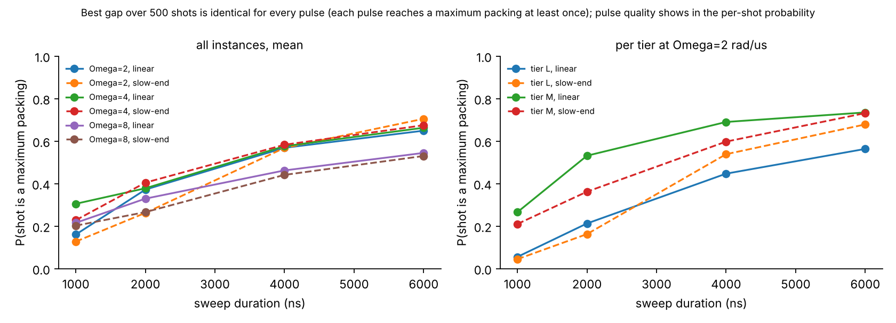
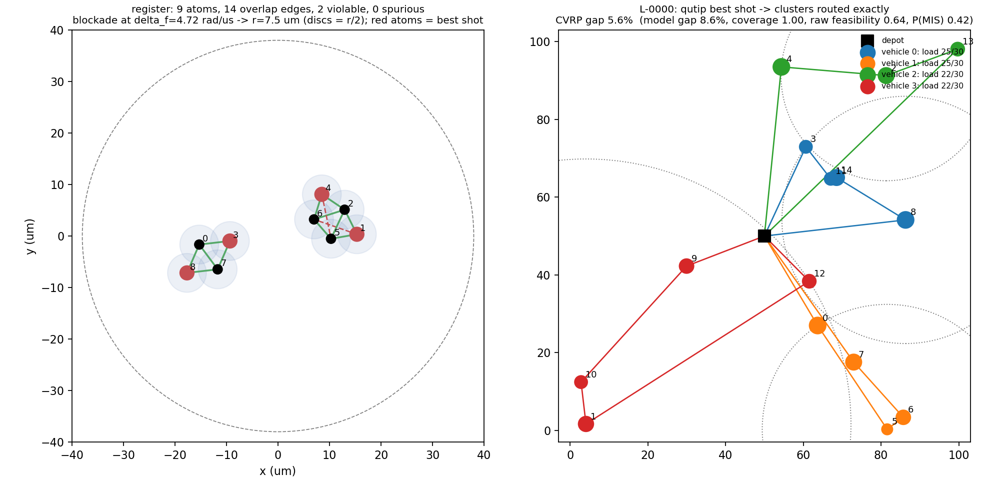

## 1. Problem and decomposition

Customers $i \in \{0,\dots,N-1\}$ with positions $P_i$ and demands $d_i$; $K$ identical vehicles of
capacity $Q$ at a fixed depot (50, 50); Euclidean costs. Decision variables of the clustering step:
$x_{ik}=1$ iff customer $i$ is served by vehicle $k$. Constrained clustering model:

$$\min \sum_k \sum_{i<j} D_{ij}\, x_{ik} x_{jk}
\quad\text{s.t.}\quad \underbrace{\sum_k x_{ik} = 1\ \forall i}_{\text{equality}},\qquad
\underbrace{\sum_i d_i x_{ik} \le Q\ \forall k}_{\text{inequality}} .$$

Routes are then obtained per cluster by an exact TSP (cluster-first / route-second). Instances follow
Table 1 of the brief; each is drawn from a seed and shipped with a feasibility certificate obtained by an
exact bin-packing search (draws without a packing are rejected, so generation stays a deterministic
function of the seed). Load ratios $\rho$ are 0.55–0.93 and $d_{\max}/Q$ 0.30–0.57 (`instances/references.csv`).

**References are proven optima on every tier.** A Held–Karp dynamic programme over all $2^N$ customer
subsets gives the exact depot-anchored tour of every possible cluster at once; a set-partitioning integer
programme over the *complete* pool of capacity-feasible subsets (scipy/HiGHS, 15–32 768 columns) then
gives the CVRP optimum and, with the pairwise-distance block cost, the optimum of the clustering model.
On S and M a brute-force enumeration of all partitions agrees and counts distinct optima (vehicle
relabellings identified). Tier L takes ≈2 s. Decomposition gaps (model optimum routed exactly vs CVRP
optimum) are 0–16 % on S, 3–13 % on M, 1–12 % on L.

## 2. What the register minimises, and what that rules out

Once the amplitude is back at zero, Eq. (1) of the brief is the classical cost
$E(n) = -\delta \sum_a n_a + \sum_{a<b} \frac{C_6}{r_{ab}^6}\, n_a n_b$.
Through the laser I control one global $\delta$: every variable has the *same* linear coefficient.
Through the positions I control the couplings, but they are all positive and fall as $1/r^6$; nothing is ever
exactly uncoupled, and with 5 µm minimum separation and 38 µm radius the useful band is roughly
5–10 µm (doubling the distance divides the coupling by 64). At $\Omega_{\max}=12.57$ rad/µs the blockade
radius is $(C_6/\Omega)^{1/6}=6.4$ µm. This cost is maximum independent set (MIS) on a unit-disk graph.

Two consequences shaped everything. (i) *Linear terms carry no information* without the DMM. On the
one-hot manifold $\sum_k x_{ik}=1$ that is harmless: any per-customer coefficient gives
$\sum_k c_i x_{ik} = c_i$, a constant, so expanding a quadratic load penalty $\sum_k (L_k - T)^2$,
$L_k=\sum_i d_i x_{ik}$, leaves only $2\sum_k\sum_{i<j} d_i d_j x_{ik}x_{jk}$: heavy customers repel
within a vehicle, no slack, no linear term — but a *dense* coupling pattern. (ii) *Dense couplings cannot
be realised*: an atom can have about three strongly coupled neighbours whose mutual couplings are weak,
and mutually conflicting atoms must fit inside one blockade disc. Any model needing more is an
approximation whose error must be measured; I measured it by brute-forcing the ground state of the
*realised* register cost (`embedding.classical_ground_states`, `manifold_check`) before any emulation.

### Variable accounting (Derive 4.1)

| encoding | count | S | M | L | fits 80? |
|---|---|---|---|---|---|
| assignment variables only | $NK$ | 8 | 30 | 60 | yes |
| + binary slack, $\lceil\log_2(Q{+}1)\rceil$ bits/vehicle | $NK + K\lceil\log_2(Q{+}1)\rceil$ | 14 | 45 | 80 | S, M; L on paper only (slack couples to every assignment atom) |
| one-hot by blockade, no slack | $NK$ | 8 | 30 | 60 | yes, but unembeddable at M/L (§5) |
| **ball packing (this work)** | #candidates $\le N$ | 2–4 | 5–6 | 6–10 | yes, exact state-vector emulation on every tier |

## 3. The model: capacity by construction, packing by blockade

Instead of penalising the inequality, I changed what the register is asked for. For every customer
centre, take the nearest customers in order of distance until the load would exceed $f\,Q$
($f=0.85$); that set is a **candidate cluster, capacity-feasible by construction**. Near-duplicate
candidates (Jaccard overlap > 0.6) are thinned, because candidates that pairwise overlap must sit
inside one blockade disc and cliques larger than three or four cannot. One atom per candidate; two atoms
are placed inside the blockade radius iff their candidates share a customer. With a uniform positive
final detuning the ground state is a **maximum set of pairwise-disjoint compact clusters**. Two
candidates overlap only when their centres are close on the map, so the conflict graph is close to a
unit-disk graph of the map itself: the register is the map at scale, which is what a neutral-atom array
embeds best. The classical parts are light: sorting by distance to build candidates, and a greedy
completion that assigns each uncovered customer to the chosen cluster with the cheapest marginal
distance that has slack (opening a new cluster while fewer than $K$ exist). The covered fraction is
reported for every shot. There is no penalty weight to tune; the knobs are $f$ and the Jaccard threshold.

**Selection rule (stated).** The answer is the device's best *raw-feasible* shot: an independent set of
at most $K$ candidates with the most candidates kept, then the lowest objective after greedy completion.
Overlap resolution (drop overlapping candidates, most compact first) is only a fallback and is flagged
as `repaired`. The best objective over all shots after full post-processing is reported separately
(`cvrp_gap_pct_any`) because that is what a purely classical completion would claim.

## 4. Embedding and pulse

**Embedding (A3).** Positions are fitted by least squares in log-distance (L-BFGS with analytic
gradients, restarts from the candidate centres): conflict pairs at 6.0 µm (18.6 rad/µs), non-conflict
pairs beyond 9.5 µm (1.2 rad/µs), then a hard projection onto the envelope (≥ 5 µm, ≤ 38 µm radius),
which pulser's `AnalogDevice` validates. Fidelity formulas:
$\mathrm{rel\_err}=\sqrt{\sum_{\text{wanted}}(U-T)^2/\sum T^2}$, log-RMS of $\ln(U/T)$ over wanted
pairs, the leakage ratio $\sum_{\text{unwanted}} U/\sum_{\text{wanted}} T$, and — the one that predicts
the physics — the graph-level count of **violable edges** (conflict pairs realised below $\delta_f$) and
**spurious edges** (non-conflicts above it). On the 15 instances the registers have 0–8 violable and
0 spurious edges out of 0–26 overlap edges (`results/results.csv`, columns `violable_edges_levels`).

**Final detuning and amplitude.** $\delta_f=\sqrt{18.6\times1.2}=4.7$ rad/µs sits at the geometric
mean of the conflict coupling and the floor, so a conflict pair costs more than two excitations gain and a
non-conflict pair costs less. $\Omega_{\max}=4$ rad/µs gives a blockade radius of 7.7 µm, between the
two design distances. The detuning starts at $-1.5\,\delta_f$ so the initial state is the empty register.

**Pulse (A4).** Baseline: three-point interpolated amplitude $0\to\Omega_{\max}\to0$, linear detuning,
4000 ns (device maximum 6000 ns). I scored pulses by the metrics that reward good shots — feasibility
rate, $P(\text{shot is a maximum packing})$ and the best gap — not by mean energy. The sweep over
duration {1, 2, 4, 6} µs, $\Omega_{\max}\in\{2,4,8\}$ rad/µs and a `slow-end` detuning that spends
70 % of the sweep on the positive side (240 emulations, `results/pulse_sweep.csv`, Fig. 2) gives a clean
adiabaticity curve: $P(\text{max packing per shot})$ rises monotonically with duration, on L from 0.06 at
1 µs to 0.45 at 4 µs and 0.68 at 6 µs, on M from 0.27 to 0.74, while the **best gap over 500 shots is the
same for every pulse** — even the 1 µs sweep reaches a maximum packing at least once. $\Omega_{\max}=8$
is worst at every duration (its blockade radius, 6.9 µm, sits too close to the 6 µm conflict distance
and blurs the conflict/non-conflict distinction); 2 and 4 rad/µs are equivalent. `slow-end` helps on L
at 6 µs (0.68 vs 0.56 at $\Omega=2$) and is neutral on M. Raw feasibility barely depends on the pulse
(0.57–0.83): diabatic sweeps still return independent sets, just smaller ones. Final choice: 6 µs,
$\Omega_{\max}=2$, `slow-end`.

## 5. Results

Emulation: pulser 1.9.1, `AnalogDevice` (automatic trap layout), exact QuTiP state-vector backend
(≤ 10 atoms, so no bond dimension is involved), 500 shots per run, 3 runs per instance, baseline pulse
(4 µs, $\Omega_{\max}=4$, linear). Every row of `results/results.csv` carries the Section 9 metrics.
Means are over the 5 instances of a tier; "any-shot" is the best gap after full post-processing of every
shot, i.e. what a classical completion would claim.

| tier | atoms | sampler | raw feas. | $P$(max packing/shot) | CVRP gap mean / best | $P(\text{gap}\le1\%)$ | any-shot |
|--|--|-----------------------|----|-----|------|----|----|
| S | 2–4 | QuTiP sweep | 0.80 | 0.75 | 7.5 % / 0.0 % | 0.60 | 1.3 % |
| M | 5–6 | QuTiP sweep | 0.76 | 0.68 | 6.5 % / 0.0 % | 0.60 | 3.6 % |
| L | 6–10 | QuTiP sweep | 0.66 | 0.47 | 14.7 % / 5.6 % | 0.00 | 14.7 % |
| M | 5–6 | ideal MIS (target graph, no physics) | 1.00 | 1.00 | 6.5 % / 0.0 % | 0.60 | 6.5 % |
| M | 5–6 | oracle: exact ground state of realised register | 0.80 | 0.80 | 12.8 % / 0.7 % | 0.20 | 12.8 % |
| L | 6–10 | oracle: exact ground state of realised register | 0.80 | 0.80 | 16.9 % / 5.6 % | 0.00 | 16.9 % |
| M | 5–6 | random bitstrings, same post-processing | 0.20 | 0.07 | 6.5 % / 0.0 % | 0.60 | 3.6 % |
| L | 6–10 | random bitstrings, same post-processing | 0.10 | 0.01 | 13.8 % / 2.8 % | 0.00 | 14.7 % |

Three observations. **Raw feasibility tracks the embedding.** L-0003 has 8 of 26 overlap edges realised
below $\delta_f$ and 24 % of its shots are valid packings; L-0001 and M-0002 have none and 100 %.
**The sweep beats the exact ground state** (M: 6.5 % vs 12.8 % mean gap): the sweep also samples low
excited states and the pipeline keeps the best feasible shot — the brief's point that one good shot is
what matters, and the reason pulses are scored per shot. **Against random bitstrings through identical
post-processing**, the register wins where the device does its job — maximum packings per shot, 0.47 vs
0.01 on L and 0.68 vs 0.07 on M — while on the final gap random best-of-500 ties on M and is better on one
L instance (2.8 %): at ≤ 10 atoms a maximum independent set is hit by luck in a few percent of random
strings, and the greedy completion is strong. The quantum part is a per-shot advantage of roughly 10–50× in
valid maximum packings, not a solution-quality advantage at these sizes; I report both. Model gaps (clustering objective vs its constrained
optimum) are larger than CVRP gaps on every tier: the packing optimises compactness through candidate
construction, not the pairwise objective, and the exact routing step forgives it. Decomposition loss of
cluster-first / route-second is 1–16 % by itself. Tier S is degenerate for this model (candidates hold 1–2
customers, so the device solves nothing that the completion step cannot) and is covered instead by the
exhaustive ground-state checks of §6.

{width=88%}

{width=82%}

## 6. What did not work

* **Dense one-hot by blockade (8 / 30 / 60 atoms).** Tier S: the realised register's exact ground state
  decodes to the model optimum on four of four seeds (in-group coupling 55 rad/µs, $\delta_f\approx25$).
  Tier M, $K=3$ triangles of side 5 µm, block-centred fit of the $3\times3$ coupling blocks that an
  assignment actually sees: effective coupling error 0.97–0.98 for $\beta\in\{0,1\}$; brute-forcing the
  realised energy over all 9842 clusterings, the realised minimiser is 57–253 % above the model optimum
  and the model optimum ranks 1349th–4770th. A $K$-gon per customer cannot be oriented for ~10 partners
  at once, and the $K=4$ square has a 7.07 µm diagonal whose coupling is 1/8 of the side's
  ($\sqrt2^{\,6}=8$), so one-hot at $K=4$ is marginal regardless.
* **Dense one-bit bisection (N atoms).** Exact at $N=4$; at $N=10$ and 15 every pair wants a coupling, the
  fit crams all atoms into an 8–10 µm disc (log-RMS coupling error 2–2.4) and the realised ground state is
  25–55 % above the $K=2$ optimum.
* **Hierarchical bisection on a sparse far-conflict graph** embeds cleanly at ≤ 2 edges per atom but is
  too weak a model: even the ideal MIS gives mean gaps of 10–16 % (M) and 21–24 % (L).
* **Richer candidate pools** (two fill levels per centre, grid centres) raise coverage on paper and destroy
  the embedding: overlap cliques, 23 of 51 edges violable, 0 % raw feasibility.
* Not attempted: DMM-weighted packing (emulation only), Track B.

## 7. Reproduction and AI use

`README.md` gives the one-command path (instances → references → classical and QuTiP runs →
figures); `requirements.txt` and `report/pinned.txt` pin the environment. Claude was used for
brainstorming, the derivations' first drafts, most of the code and this report's draft; every claim was
re-run and every derivation re-done by a team member, as recorded in `AI_USE.md`.
